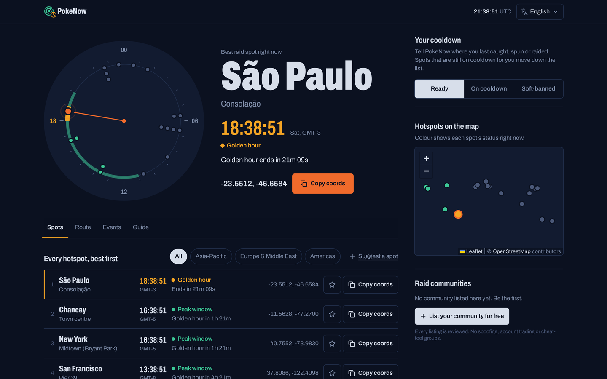
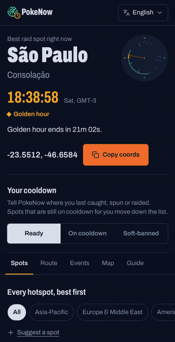
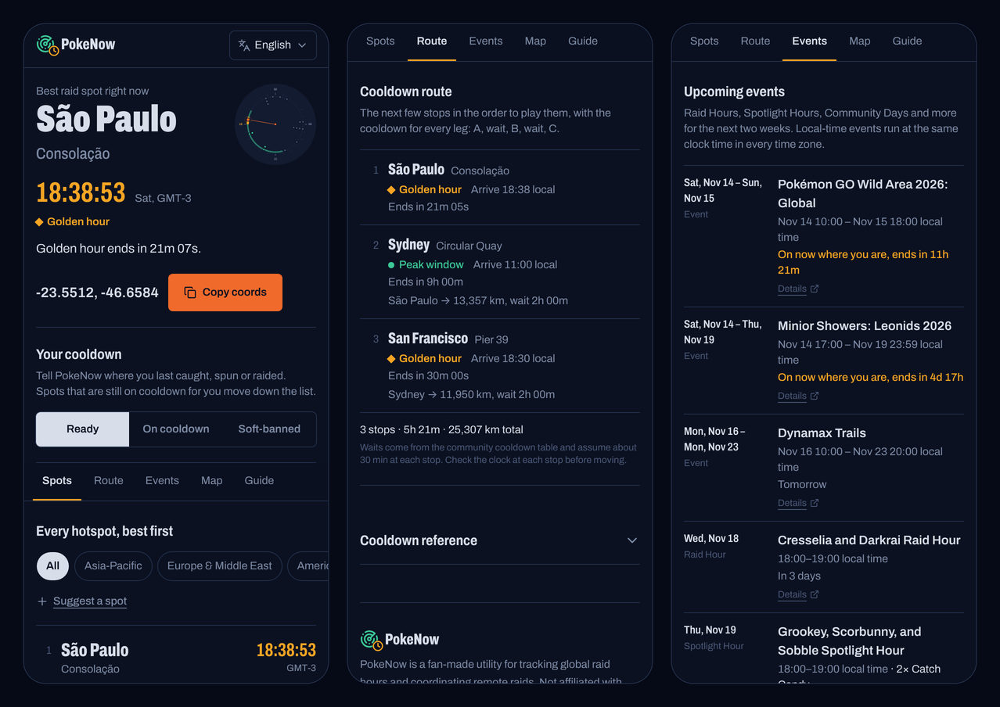

<p align="center">
  
</p>

<h1 align="center">PokeNow</h1>

<p align="center">
  <strong><a href="https://pokenow.cc">pokenow.cc</a></strong> — which Pokémon GO raid hotspot on Earth is busiest right now.
</p>

<p align="center">
  <a href="https://pokenow.cc"></a>
  <a href="https://github.com/Churious/pokenow/actions/workflows/deploy-pages.yml"></a>
  <a href="LICENSE"></a>
  
  
</p>

<p align="center">
  
  
  
  
  
</p>

<p align="center">
  
</p>

PokeNow watches the local time at 19 well-known raid spots around the world and points you to the one where lobbies are
most likely to fill, with the coordinates one tap away. It is a fan-made site: free to use, no accounts, no app.

This repository is the site's source code, published so anyone can see how the ranking works and check what runs in their
browser. It is **source-available, not open source**: see [License](#license).

> Not affiliated with Scopely, Nintendo or The Pokémon Company. PokeNow doesn't provide or endorse location-changing tools.

## What the site does

- **Best spot now**: every spot ranked live by its local time (18:00 Raid Hour / Spotlight Hour window first, then the
  11:00–20:00 peak), re-checked every second.
- **Cooldown-aware**: tell it where and when you last played and it ranks spots by when you can safely play there, and
  plans the next few stops as A → wait → B → wait → C.
- **Event schedule**: Raid Hours, Spotlight Hours, Community Days and current raid bosses in your local time, from the
  community-run Leek Duck calendar.
- **A page per spot** with a live clock, countdowns, map links and a share button; pinned favourites; 14 languages.
- **Reports without a GitHub account**: translation fixes and new-spot suggestions go straight from the site to this
  repo's issues.

<p align="center">
  
  &nbsp;&nbsp;
  
</p>

## How the ranking works

| Tier | Local time | Meaning |
| --- | --- | --- |
| Golden | 18:00 – 18:59 | Raid Hour (Wed) / Spotlight Hour (Thu) window |
| Peak | 11:00 – 19:59 | General raid activity |
| Upcoming | 20:00 – 10:59 | Ordered by time until the next window opens |

Ties go to the spot nearer your last action, then by id. There is no popularity weight because there is no measured data
for it. With a last action set, each spot waits `cooldown(distance) − time since your action` (capped at 2 h) and is
ranked by the window it will be in when you arrive. Details: [`src/lib/scoring.ts`](src/lib/scoring.ts),
[`src/lib/planner.ts`](src/lib/planner.ts).

## Data and its limits

- **Spots**: each entry in [`src/data/hotspots.ts`](src/data/hotspots.ts) cites where its coordinates come from. They
  are places raid players commonly use, not a guarantee of Gym or PokéStop density. PokeNow never shows Gym/PokéStop
  locations.
- **Cooldowns**: an unofficial community table; sources disagree, so values are rounded to the safer side.
- **Events**: read at runtime from [ScrapedDuck](https://github.com/bigfoott/ScrapedDuck), a mirror of
  [Leek Duck](https://leekduck.com)'s calendar. Names only, no artwork. Official announcements win.

## Privacy

Your last action, pinned spots and language stay in your browser's localStorage and are never sent anywhere. Details in
[privacy.html](https://pokenow.cc/privacy.html).

## Feedback

- **On the site**: footer → *Report a translation problem*, or *Suggest a hotspot* under the ranking. No account needed.
- **On GitHub**: [issues](https://github.com/Churious/pokenow/issues/new/choose) for spots, translations, raid
  communities (free listing) and bugs.

New issues for translations and community listings get an automatic first-pass review comment (Gemini); a maintainer
makes the call. Pull requests from outside aren't accepted: open an issue instead and the change will be made here.

## Running it locally

```bash
npm install
npm run dev      # http://localhost:5173
npm test
npm run build    # → dist/
```

Node `^20.19.0 || >=22.12.0`. React 19, TypeScript, Vite 8, Tailwind 4, Leaflet. Deployment, ads and analytics notes
are in [`docs/OPERATING.md`](docs/OPERATING.md).

## License

[PolyForm Noncommercial 1.0.0](LICENSE). In short, and the license text decides:

- **Allowed**: reading the code, running it, changing it and sharing it for noncommercial purposes (personal use,
  study, hobby projects, charities and similar organisations).
- **Not allowed**: any commercial use, including running a copy of the site with ads or as part of a paid product.
- Keep the license and the `Required Notice` line with any copy.

Want to use it in a way that isn't covered? Open an issue and ask.

Versions published before this change (up to commit `8a25c82`) were released under MIT, and those copies stay MIT.
